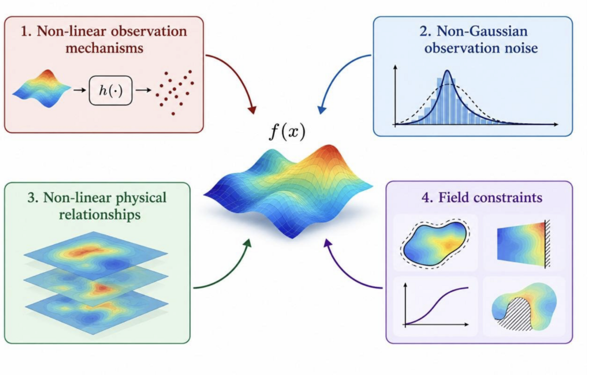

<p align="center">
  <picture>
    <source media="(prefers-color-scheme: dark)" srcset="assets/logo-dark.svg">
    
  </picture>
</p>

[](https://github.com/FlowInference/flow-inference/actions/workflows/ci.yml)
[](https://flowinference.github.io/flow-inference/)

Guided flow-based sampling of stochastic processes under user-specified conditions.

<p align="center">
  
</p>

`flow_inference` draws samples of a stochastic process (a Gaussian process, an SDE
solution, or anything a neural flow can be trained on) that satisfy a condition you
supply: an ODE or PDE residual, a shape constraint such as monotonicity, a
point-process likelihood, and so on. It does this by integrating a probability-flow
ODE (or SDE) from noise to the process, steering each step with a guidance term
computed from the condition's log-likelihood.

<p align="center">
  
</p>

> **Want to see the examples run?** The notebooks in this repository are stored
> without outputs. Browse them fully executed, with every figure, at
> **<https://flowinference.github.io/flow-inference/>**.

## Installation

```bash
pip install -e .                  # the library
pip install -e ".[examples]"      # plus what the example notebooks need
```

Requires Python 3.12+. The library depends only on `torch`, `gpytorch` and `tqdm`.

## Quickstart

Sample functions from a GP prior, conditioned to average to 1 over the domain:

```python
import gpytorch
import torch

from flow_inference.conditions import EqualityCondition
from flow_inference.flow_utils import build_grid_in_box
from flow_inference.flows import GaussianProcessFlow
from flow_inference.guidance import GuidanceMC
from flow_inference.sampler import IntegratorSampler

# A GP prior on 128 points in [0, 1].
grid = build_grid_in_box(128, 1)
kernel = gpytorch.kernels.ScaleKernel(gpytorch.kernels.RBFKernel())
kernel.base_kernel.lengthscale = 0.1
flow = GaussianProcessFlow(kernel, gpytorch.means.ZeroMean(), grid)


# Condition: the sampled function must average to 1 over the domain.
class MeanIsOne(EqualityCondition):
    def residual(self, x):  # x: (batch, channels, points)
        return x.mean(dim=-1, keepdim=True) - 1.0


guidance = GuidanceMC(flow, MeanIsOne(sigma=1e-2), num_mc_samples=10)
samples = IntegratorSampler(flow).sample(16, guidance=guidance, num_steps=500)
# samples: (16, 1, 128), each averaging ~1
```

To condition on data as well, build the flow from a GP posterior instead:
`mean, kernel = gp_posterior(kernel, X, y)` from `flow_inference.gp_utils`.

### Precision

The library works in float32, which is much faster on GPUs. The exception is the
kernel matrix: `GaussianProcessFlow`, `gp_posterior`, `fit_kernel_hyperparameters`
and the GP-based maps assemble and factorise it in float64, because GP Gram matrices
are too badly conditioned for a float32 factorisation, and then store the result in
the working dtype. A flow takes its working dtype from its kernel; to run in float64
throughout, build the kernel in float64 or pass `dtype=torch.float64` to
`GaussianProcessFlow`. Conditions should match the flow's dtype: a float64 condition
on a float32 flow works but runs in float64, so the guidance warns about it
(`condition.float()` fixes it).

## Related papers

The methods in this library are developed in:

- **Conditioning Gaussian Processes on Almost Anything.** H. Moss, L. Astfalck,
  T. Cowperthwaite, C. Doumont, S. Willis, P. Hennig, C. Nemeth, A. Zammit-Mangion.
  NeurIPS 2026. [arXiv:2605.21041](https://arxiv.org/abs/2605.21041)
- **LatentFlow: A General Framework for Conditioning Stochastic Processes.**
  L. Sharrock, L. Astfalck, H. Moss. Preprint, 2026.
  [arXiv:2607.12922](https://arxiv.org/abs/2607.12922)
- **Feature Space Adaptation for Effortless Gaussian Process Flows.**
  T. Cowperthwaite, L. Sharrock, L. Astfalck, H. Moss. Preprint, 2026.
  [arXiv:2610.11459](https://arxiv.org/abs/2610.11459)
- **Spatial Prediction with Guided Diffusion.** A. Zammit-Mangion, L. Astfalck,
  R. Huser, C. Nemeth, H. B. Moss. Preprint, 2026.
  [arXiv:2610.12967](https://arxiv.org/abs/2610.12967)

## Examples

Each notebook in [`examples/`](examples/) is self-contained. Rendered versions, with
all figures, are at <https://flowinference.github.io/flow-inference/>.

| Notebook | Condition | Problem |
|---|---|---|
| [Monotonic_gaussian_process](examples/gaussian_processes/Monotonic_gaussian_process.ipynb) | Shape constraints | Monotonic, bounded GP |
| [Pendulum_gaussian_process](examples/gaussian_processes/Pendulum_gaussian_process.ipynb) | ODE | Nonlinear damped pendulum |
| [Burgers_gaussian_process](examples/gaussian_processes/Burgers_gaussian_process.ipynb) | PDE + Dirichlet BCs | Viscous Burgers equation |
| [Allen_cahn_gaussian_process](examples/gaussian_processes/Allen_cahn_gaussian_process.ipynb) | PDE + periodic BCs | Allen–Cahn equation |
| [Inhomogeneous_poisson_process](examples/gaussian_processes/Inhomogeneous_poisson_process.ipynb) | Point process | Inhomogeneous Poisson process |
| [Hawkes_process](examples/gaussian_processes/Hawkes_process.ipynb) | Point process | Hawkes process |
| [Spatial_processes](examples/spatial_processes/Spatial_processes.ipynb) | Point, areal and censored observations | Gaussian, Student-t and Cauchy-convolution fields |
| [Neural_flow](examples/spatial_processes/Neural_flow.ipynb) | Various | Flow learned from unconditional samples (GPU recommended) |
| [Heston_stochastic_volatility](examples/stochastic_differential_equations/Heston_stochastic_volatility.ipynb) | Data + market-shock event | Heston stochastic volatility SDE |
| [Lotka_Volterra_stochastic_process](examples/stochastic_differential_equations/Lotka_Volterra_stochastic_process.ipynb) | Data + prey-boom event | Stochastic Lotka–Volterra |
| [SIR_stochastic_process](examples/stochastic_differential_equations/SIR_stochastic_process.ipynb) | Data + fast-epidemic event | Stochastic SIR epidemic |
| [Advection_diffusion_plume](examples/spatio_temporal_processes/Advection_diffusion_plume.ipynb) | Sensors, obstacle and detector events | Advection–diffusion plume |
| [FitzHugh_Nagumo_excitable_medium](examples/spatio_temporal_processes/FitzHugh_Nagumo_excitable_medium.ipynb) | Pacemaker firing patterns | Stochastic FitzHugh–Nagumo medium |
| [Stochastic_Allen_Cahn_phase_field](examples/spatio_temporal_processes/Stochastic_Allen_Cahn_phase_field.ipynb) | Sensors and final-field region means | Stochastic Allen–Cahn phase field |

## Package layout

| Module | Contents |
|---|---|
| `flows` | The flows to sample from: `GaussianFlow`, `GaussianProcessFlow` (function space), `BasisGaussianProcessFlow` (weight space), `GaussianIncrementFlow`, `NeuralFlow` (learned) |
| `conditions` | What samples should satisfy: `EqualityCondition` (residuals), `BinaryCondition` (inequalities), `PointWiseCondition`, `ProductCondition` |
| `guidance` | How the condition steers sampling: `GuidanceDPS`, `GuidanceMPGD`, `GuidanceMC` |
| `sampler` | `IntegratorSampler` (ODE/SDE integration) |
| `gp_utils` | GP posteriors, kernel fitting, and random-Fourier-feature bases |
| `maps`, `training_samplers` | Non-Gaussian spatial processes (Student-t, Brown–Resnick, Lévy–NIG, ...) as maps from Gaussian noise, and the training data they provide for `NeuralFlow` |
| `schedules`, `flow_utils` | Noise schedules and grid helpers |

The main classes and functions are also importable from the top level
(`from flow_inference import GaussianProcessFlow, GuidanceMC, IntegratorSampler`).

### Benchmarks

[`benchmarks/`](benchmarks/) sits outside the library and is not installed with it.
It holds classical methods that run on the same whitened target as the guided
samplers, for use as baselines:

- `benchmarks/mcmc.py`: preconditioned Crank–Nicolson (`pcn`) and its gradient
  version (`pcn_mala`), elliptical slice sampling (`elliptical_slice`), Hamiltonian
  Monte Carlo (`hmc`), the No-U-Turn Sampler (`nuts`, via Pyro) and
  likelihood-tempered SMC (`tempered_smc`);
- `benchmarks/ep.py`: expectation propagation (`ep`), a Gaussian approximation for
  conditions that factorise into sites on linear functionals of the field (point
  observations, monotonicity, bounds);
- `benchmarks/lin_ess.py`: reference answers for conditions made of linear
  inequalities and Gaussian observations: exact draws by LIN-ESS and the evidence by
  subset simulation (`lin_ess`), to score the other methods against.

A script compares them with guided sampling on a shared likelihood budget, by
default on a GP regression problem whose exact posterior is known. NUTS needs the
`benchmarks` dependency group (`pip install -e . --group benchmarks`).

```bash
python -m benchmarks.innovation_space --num-samples 500
python -m benchmarks.innovation_space --methods NUTS EP   # a subset
```

## Development

Install the development tools and the pre-commit hooks (`--group` needs pip 25.1+, or
use `uv sync`):

```bash
pip install -e . --group dev
pre-commit install --install-hooks        # ruff + notebook output stripping on commit
pre-commit install --hook-type pre-push   # test suite must pass before push
```

Notebooks are committed with their outputs stripped (via `nbstripout`). To publish the
rendered notebooks, execute them at full budget (a GPU helps) and deploy the site to the
`gh-pages` branch, which keeps a single commit:

```bash
pip install -e ".[examples]" --group dev --group docs
python scripts/build_docs.py              # runs new/changed notebooks into build/docs
mkdocs serve                              # preview locally
mkdocs gh-deploy --force --no-history     # publish
```

## Tests

```bash
pytest               # fast suite
pytest -m slow       # slow tests only
pytest -m notebooks  # smoke-run every example notebook (about a minute on CPU)
```

The notebook smoke tests execute each notebook with capped sampling and training
budgets, so they check that the examples run, not that their results are good.

## Citation

If you use `flow_inference` in your work, please cite it (GitHub's "Cite this
repository" button exports this from [`CITATION.cff`](CITATION.cff)):

```bibtex
@software{moss2026flowinference,
  author  = {Moss, Henry and Astfalck, Lachlan and Cowperthwaite, Thomas and Sharrock, Louis and Zammit-Mangion, Andrew},
  title   = {flow\_inference: guided flow-based sampling of stochastic processes},
  year    = {2026},
  version = {0.1.0},
  url     = {https://github.com/FlowInference/flow-inference}
}
```

## Licence

MIT; see [LICENSE](LICENSE).
